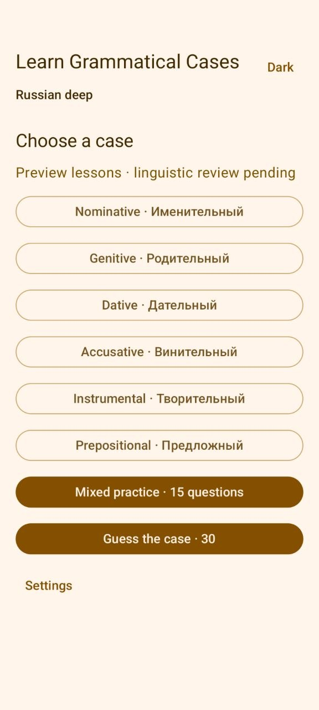
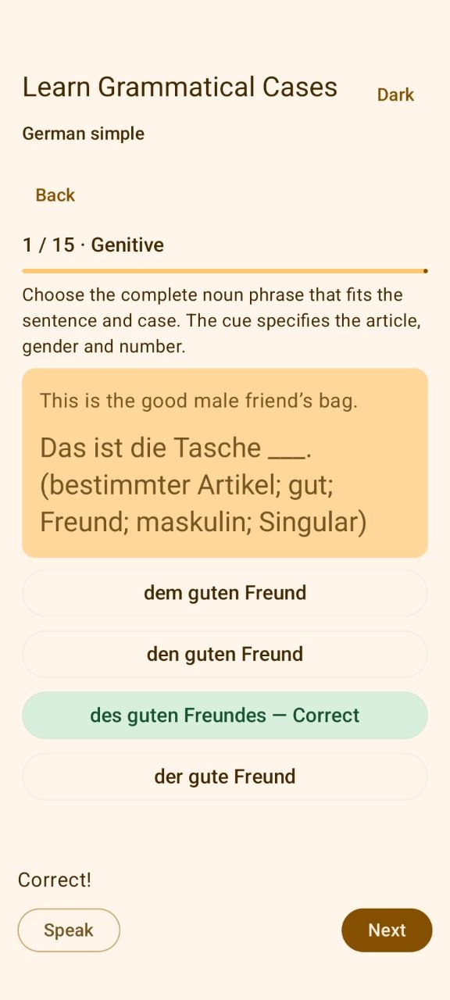
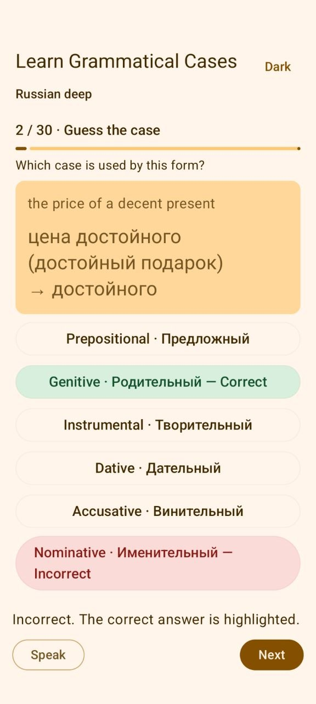

# Learn Grammatical Cases

I want to learn Russian cases through practical examples, rather than only
memorising grammar tables. This project is my attempt to build an Android app
for that purpose, with help from AI.

Like my Polar project, this is an experiment in AI-driven development. I provide
the ideas, questions and direction; AI helps turn them into plans, learning
material and code. Russian is my personal starting point, but the long-term goal
now includes German as well as Slavic languages. I am releasing the project as open source so
others can contribute examples, improve it, or continue it in a fork.

**Current status:** the Android app contains Russian/Polish simple and deep packs, a German simple pack, mixed practice,
guess-the-case sessions, English/German/Russian/Polish controls and speech support. The 1,722
draft questions still need linguistic review. The Android app ID and repository
URL retain their original names so existing installations and links keep working.
The original prototype passed emulator tests; the German addition awaits device
testing. The project uses the [MIT license](LICENSE).

## Screenshots

| Main menu | Russian genitive topics |
| --- | --- |
|  |  |

| German genitive practice | Guess the case |
| --- | --- |
|  |  |

## Set up for development

New to Android development? Follow the [step-by-step setup guide](AI/DEVELOPMENT.md#step-by-step-setup).
It explains installation, checking the tools, starting Android Studio, and the
remaining steps before we can build the app. The installer supports Linux x86-64.
You do not need Android tools to contribute sample sentences.

After installing the SDK and Python content tools, prepare dependencies and build:

```bash
bash scripts/install-build-tools.sh
```

For later builds with dependencies already cached:

```bash
bash scripts/build.sh
```

The debug APK is generated at `app/build/distributions/learn-grammatical-cases-debug.apk`.
The setup guide explains how to install it on a phone or use the optional emulator.

## Planned learning experience

Choose a grammatical case, then practise nouns or adjectives and numerals using
four answer options (three in some deep lessons). Mixed practice combines questions
across cases and tracks. Guess the case shows completed examples and asks you to
choose their grammatical case, using 30 random questions from the selected pack
by default. Its question count is adjustable in Settings.
Correct selections turn green and incorrect selections red. A speech button reads
the selected answer, Next continues the session, and a results page offers Repeat
or Back. Settings can enable automatic continuation after a two-second feedback
pause; pressing Speak pauses continuation until Next is pressed. GUI language and
learning language have independent settings. The in-app title follows the interface
language: “Learn Grammatical Cases” / “Grammatische Fälle lernen”. The name under
the phone launcher icon follows the phone language, with English as the fallback.
Sample-set and topic buttons follow the interface language too (for example,
“Russian deep” becomes “Russisch vertieft”). Settings shows a date-only build date.

## German lessons

[German simple](samples/de/README.md) provides 120 starter questions across
nominative, genitive, dative and accusative. Exercises use complete noun phrases
so articles, adjective endings and noun endings can be practised together. They
cover all three genders, plurals, weak masculine nouns, and cardinal/ordinal numbers.
When interface and learning language are both German, the translation is hidden
to avoid revealing the answer. Russian remains the default learning language.

## Starter sample sets

| Learning language | Cases | Noun questions | Adjective/numeral questions | Total |
| --- | --- | --- | --- | --- |
| Russian | 6 | 90 | 90 | 180 |
| Polish | 7, including vocative | 105 | 105 | 210 |
| German | 4 | 60 | 60 | 120 |

Each case/track file contains 15 questions. Samples include English and German
native-language text plus a neutral prompt in the learning language. The noun and
adjective tracks live in separate folders under [samples/](samples/README.md).
Numerals are in the adjective track but labelled as cardinal or ordinal numerals.
The Russian/Polish initial sets focus on singular person nouns/adjectives, ordinal agreement,
and quantities one, two and five with books. Polish vocative numeral questions
use ordinals in direct address. These sets cover every declared case and track;
they are starter material rather than a complete grammar course.

## Translating the interface

Interface text is in [English strings.xml](app/src/main/res/values/strings.xml) and
[German strings.xml](app/src/main/res/values-de/strings.xml),
[Russian strings.xml](app/src/main/res/values-ru/strings.xml), and
[Polish strings.xml](app/src/main/res/values-pl/strings.xml), including button texts.
Keep resource IDs and numbered placeholders unchanged. See the
[translation guide](AI/DEVELOPMENT.md#translating-the-interface) for validation and
adding languages. Lesson text, sample-set names and topic labels remain in YAML.

## Creating a sample set

You can write samples in any plain-text editor; no Android programming is needed.
Use UTF-8 YAML and follow an existing example, such as
[Russian noun practice](samples/ru/nouns/dative.yaml) or
[Polish adjective practice](samples/pl/adjectives/accusative.yaml).

1. Choose the learning language folder, for example `samples/ru/` or `samples/pl/`.
   For a new language, copy [the language template](samples/templates/language.template.yaml)
   to `samples/<language-tag>/language.yaml` and declare its teaching cases, at most eight.
2. Copy [the noun template](samples/templates/nouns.template.yaml) into its `nouns/`
   folder, or [the adjective/numeral template](samples/templates/adjectives.template.yaml)
   into its `adjectives/` folder. Use a descriptive filename such as `dative-family.yaml`.
3. Replace the placeholders and give the sample and every question a unique ID.
   Set the language, case, contributor, source and license. Keep `review_status: draft`
   until linguistic review is complete. You must have permission to redistribute the material.
4. Fill all 15 questions with native-language sentence text, a neutral prompt in the
   learning language containing one `___` blank, and the target dictionary form.
   Keep the native text inside each sample. Change the native language tags/list
   together if you supply translations other than English and German.
5. Supply four different answers, labelled `a` to `d`, and set `correct` to the key
   of the correct answer. Use `answer_scope: word` for a single word or `phrase` when
   the complete numeral/noun phrase is being practised. Do not include a second valid
   answer as a distractor. Preserve accents and other meaningful letters.
6. Validate the files, or ask a maintainer to validate them when submitting.

With Python and PyYAML already installed, run from the project root:

```bash
python3 scripts/validate-samples.py
```

For Linux with Python 3.12 and virtual-environment support, a reusable installer
prepares an isolated validator environment outside the checkout:

```bash
bash scripts/install-content-tools.sh
"$HOME/.local/share/slavic-cases/content-venv/bin/python" scripts/validate-samples.py
```

The installer pins PyYAML and verifies wheel checksums. It has not been run in
this project session; validation used the machine's existing PyYAML installation.
If you use another platform or cannot run the validator, you can still submit
sample text for a maintainer to check. Structural validation checks the file format;
a person familiar with the language must check the grammar and answers.
See [the detailed content format](AI/CONTENT_FORMAT.md) for the schema and review rules.

## Contributing samples and providing feedback

To propose files, [fork this repository](https://github.com/ewanold/slavic-cases/fork),
copy/edit the templates in your fork, commit the changes, then open a pull request
against the original repository. You can edit text files through GitHub's website;
cloning and using the command line are optional. In the pull request, describe the
language, cases and track covered, translation languages, sources/license, and
whether you checked the answers or need help reviewing them.
[GitHub's contribution guide](https://docs.github.com/en/get-started/exploring-projects-on-github/contributing-to-a-project)
explains the fork and pull-request workflow.

For corrections, suggestions, or sample text you would rather not submit through
a fork, [open an issue](https://github.com/ewanold/slavic-cases/issues/new).
Use a title such as `Polish dative: correction to student question`, and include
the sample filename, question ID, current wording, proposed correction, and a short
explanation or reference. You can also paste a new sample into an issue inside a
YAML code block and ask for help turning it into a file. No programming knowledge
is required. Please check existing issues first and use an existing issue or
pull-request conversation when your feedback belongs there.
[GitHub's issue guide](https://docs.github.com/en/issues/tracking-your-work-with-issues/using-issues/creating-an-issue)
shows how to post feedback. If Issues are not yet enabled, use a pull request.

## Development and AI handover

Start with [AI/MAIN.md](AI/MAIN.md), [the work queue](AI/TODOS.md), and
[development setup](AI/DEVELOPMENT.md). Contributors: read [AGENTS.md](AGENTS.md).
The `AI/` folder records discussion outcomes, decisions and build history so a
person or another AI session can continue the work.

Resume the original local development chat with `bash run-codex.sh`.
Fork contributors should start their own chat; cloning the repository does not
provide access to the original conversation. Use the committed AI notes instead.

Version 2 topic packs can be selected separately in Settings. Choose a case,
nouns/adjectives, then a topic; gender exercises also offer gender subgroups.
The upper-right **Light/Dark** button saves your theme preference.
Imported v2 packs are draft previews with unresolved redistribution permissions;
see [the sample audit](AI/V2_SAMPLE_AUDIT.md) before contributing or publishing them.

The learning packs are named **Russian simple**, **Russian deep**, **Polish simple**
and **Polish deep**. Version 0.2 also has a private-testing release build:
`bash scripts/build-local-release.sh`. See [development setup](AI/DEVELOPMENT.md)
for its signing and draft-content limitations.

To open Android Studio from the application menu, start it once and choose
**Tools → Create Desktop Entry**. See [development setup](AI/DEVELOPMENT.md)
for the installed executable location and project-opening instructions.
